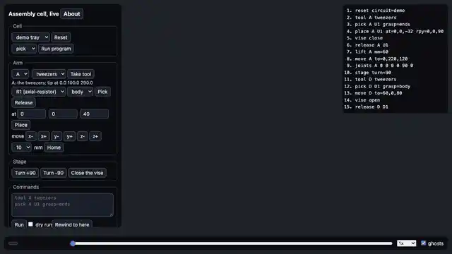
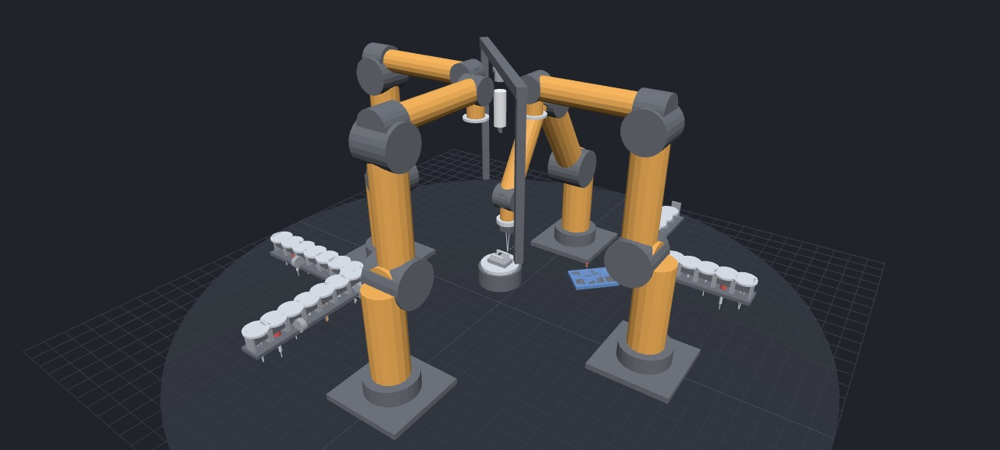
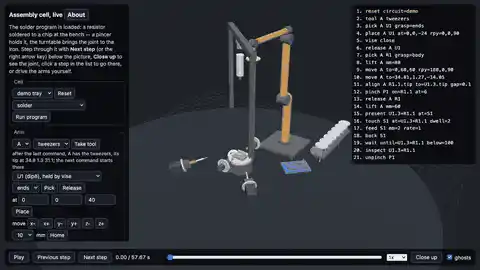
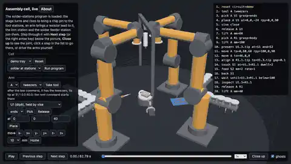

# cell

A robot assembly bench, simulated: one arm, a turntable with a vise
and pincers, tool stations (an iron that feeds its own solder, a
welder), a tool rack, trays of parts and a microscope that build
electronic circuits in free air, in 3D, from the center outward -- the
arm brings a lead to a lead, a pincer holds it there, the turntable
presents the joint to a station, and the next part comes in. A
program or an LLM agent drives it one command at a time (the design:
docs/cell-design.md in the repository).

Status: the arms move, change tools, pick, place, align and let go of
parts, stop where they touch, and solder: heat flows in leads and
bodies, an iron heats a joint, solder fed into it melts, wets and
freezes into a joint judged good or not, and a good joint holds two
parts as one; leads spot weld; tool stations work on joints the
positioner (the stage, turning, tilting and moving) presents to them;
the cell has its 3D models, and a
program can be previewed in a browser, played with a scrubber. The
parts library, the command language (text and JSON, checked against
one table), the cell's state as JSON, a six-axis arm with the
stage and the vise, collision along every motion, and a model of
every piece (built through Blender, checked against the simulator)
are in place: `reset`, `wait s=`, `joints`, `move`, `lift`, `stage`,
`vise`, `tool`, `grip`, `pick`, `place`, `align`, `release`, `back`,
`touch`, `feed`, `clip`, `weld`, `present`, `wait until=`, `inspect`
and `rewind` run;
every other command is parsed and checked, then refused as not
simulated yet. Welding, wire, forming leads, the microscope, reading
and testing parts come next.

- Package: `extensions/cell/` (`extension.toml`; library
  `xetal_ext_cell`: `libxetal_ext_cell.dylib` on macOS, `.so` on
  Linux)
- Facade: `lib/Cell.xtl`, recommended alias `ce:`; the models:
  `lib/CellModels.xtl`, alias `cm:` (pure X_eTaL, through the blender
  extension's `Bpy.xtl`)
- Native crates: `serde`, `serde_json`, `toml`
- Builds for WebAssembly: the simulator has no threads, files or
  clocks (time is the simulation's own), so the same crate will run in
  a browser; the gate builds it for `wasm32-unknown-unknown`

## Functions

| Native name | Arity | X_eTaL type | What |
| ----------- | ----- | ----------- | ---- |
| `about` | 0 | `Unit -> Char` | the extension's name and version |
| `parts` | 0 | `Unit -> Char` | the parts library, one line a kind |
| `part` | 1 | `Char -> Char` | one part kind, its pins worked out, as JSON |
| `commands` | 0 | `Unit -> Char` | the command language, one line a command |
| `parse` | 1 | `Char -> Char` | a program checked against the command table, each command as JSON |
| `run` | 1 | `Char -> Char` | a program run on a new cell, each command's outcome as JSON |
| `state` | 1 | `Char -> Char` | a program run on a new cell, the cell's state after it as JSON |
| `rig` | 0 | `Unit -> Char` | the arm's rig as JSON |
| `scene` | 2 | `Char -> Char -> Char` | a program run on a new cell, written as a scene for the players |
| `arm_model` | 0 | `Unit -> Char` | what a model of the arm must be, as JSON: its pivots, links, check poses and rig |

## From X_eTaL

```
"ce:" u_se< "Cell"
ce:a_bout @                    # cell 0.1.0
ce:p_arts @                    # dip8 8 pins: DIP-8 (NE555 timer) ...
ce:p_art "dip8"                # its body, pins, grasp frames, heat data
ce:c_ommands @                 # lift ARM [mm=MM] -- move the tool straight up ...
ce:p_arse "place A U1 at=0,0,0 rpy=180,0,0"
ce:r_un "move A to=0,0,20 rpy=180,0,0\nlift A mm=30"
ce:s_tate "stage turn=90"          # the time, arms, tracks, stage, timeline
ce:r_ig @                          # the arm's joints, limits, home
```

`ce:p_arse` there prints
`{"op":"place","arm":"A","part":"U1","at":[0.0,0.0,0.0],"rpy":[180.0,0.0,0.0]}`,
and `ce:r_un` one outcome a command:

```
{"ok":true,"command":"move A to=0,0,20 rpy=180,0,0","t0":0.0,"t1":3.932754,"did":["line A to=0,0,20 rpy=180,0,0 in 3.933 s","joints A 0 43.296 17.674 0 29.029 -90"],"events":[],"warnings":[]}
{"ok":true,"command":"lift A mm=30","t0":3.932754,"t1":4.332754,"did":["line A to=0,0,50 rpy=180,0,0 in 0.4 s","joints A 0 39.044 17.584 0 33.372 -90"],"events":[],"warnings":[]}
```

Run with `xetal-x --ext extensions/cell run PROGRAM` (see the
repository's docs/bridge.md).

## The cell

Millimeters, degrees, seconds, grams, watts and degrees Celsius; Z up,
right handed. One arm, A, stands 450 mm from the work zone at +y and
200 mm below it, facing the center (there were four, a quarter turn
apart: the bench replaced them, decision C18). A new cell (`reset`)
has the arm home with no tool, its rack full, the rotary stage at 0, the vise open, the
time 0; `reset circuit=demo` lays four parts in the tray
(`circuits/demo.toml`: a DIP-8, a resistor, an LED, a ceramic disc).

Around the arms (`layout.rs`, every number illustrative):

- the rotary stage under the work zone, its top 60 mm below the
  origin, with the vise on it: a part whose origin is within 15 mm of
  the vise's middle when it closes (or when an arm lets go of it while
  it is closed) is held, and turns with the stage;
- the microscope on its gantry, turned 135 degrees, its lens 330 mm
  above the work zone, clear of the arm's wrist;
- a tool rack beside the arm with all seven tools;
- the parts tray at +x +y, in the arm's reach;
- the tool stations and the pincers on the turntable (below).

The state is plain data and round-trips through JSON exactly: the
time, the circuit, the arms (base, joint angles, tool, track), the
stage and its track, the vise, the parts and the timeline of every
command that ran, its start and end times. Times are kept to the
microsecond. The same program always gives the same state.

## The arms

Every arm is the same generic six-axis arm, `rigs/arm.toml`: base yaw,
shoulder, elbow, and a spherical wrist (roll, pitch, flange roll),
given as classic Denavit-Hartenberg parameters with each joint's
limits, top speed and acceleration, all illustrative. It reaches about
650 mm; at all joints 0 the upper arm stands up and the forearm points
out. Home is that with the wrist pitched 90 degrees, the flange
pointing straight down 100 mm in from the ring and 390 mm above the
work zone -- not a straight wrist, a singularity.

Arms are moved by position, as industrial arms are: kinematic, not
dynamic.

- `joints ARM J1 ... J6` goes to joint angles. Every joint follows a
  trapezoidal profile (accelerate, cruise, decelerate; a triangle
  when the move is short) scaled so that all of them arrive together
  and none passes its speed or acceleration; `speed=` is the fraction
  of each joint's top speed (0.5 if not given).
- `move ARM to=X,Y,Z [rpy=R,P,Y]` takes the flange (the tool point,
  while the arm holds no tool) along a straight line, turning evenly to
  the new orientation (kept if not given), at `speed=` mm a second (100
  if not given; accelerating at 1000). The line is sampled every 1 mm
  and 1 degree; each sample's joint angles come from the inverse
  kinematics, in closed form, the solution nearest the sample before.
  The move is slowed where a joint would pass its top speed. `lift ARM
  mm=` is a move straight up (10 mm if not given).
- Orientation is roll, pitch, yaw in degrees: Rz(yaw) Ry(pitch)
  Rx(roll); a tool's approach is its z axis, so `rpy=180,0,0` points it
  straight down.
- `stage turn=DEG` turns the rotary stage (90 degrees a second,
  accelerating at 360); `vise open|close` takes 0.5 s.

A move that cannot start is refused and changes nothing, saying why: a
joint angle beyond its limits, a point out of reach, every way to
reach it beyond a limit, or a joint that would turn suddenly on the
line (it passes near a singularity: the wrist straight, or the wrist
over the base's axis), each with how far along. Every motion is
recorded in the arm's track, rows of the time and the six angles,
every 50 ms, for a player to draw.

## The live page

Live: <https://softwarewrighter.github.io/X_eTaL-extensions/cell/live/>



The cell driven in a browser, nothing installed: the simulator runs in
the page compiled to WebAssembly (it has no threads, files or clocks,
so this is a build of the same crate, not a port), with X_eTaL beside
it, and the three extension's cell player draws the cell's timeline
(`web/`: its own workspace, built by trunk).

- The page opens with `programs/pick.cell` loaded and paused at its
  start: Next step (or the right arrow key) plays its commands one at a
  time, Previous step goes back, and clicking a step goes there.
- Every control writes a command in the command language and runs it
  as the command box does -- Take tool, Pick (a part and one of its
  grasp frames), Release, Place at x y z, move the tip by a step along
  x, y or z, Home, turn the stage, open or close the vise -- for the
  arm chosen. The box takes any program, a command a line; with dry
  run each runs on a copy.
- Each outcome is listed: ok, refused (and why; nothing changed), or
  stopped (what touched what); events and warnings. The player then
  plays what the command did; its scrubber, speed and steps list go
  anywhere in the timeline, and Rewind to here goes back to the
  scrubber's time, keeping what came after, marked rewound.
- Reset lays a tray out again (demo or empty); Run program runs one of
  `programs/` (`pick`, `arms`).
- X_eTaL in this page: a program runs with the cell extension linked
  in (`ce:`); when what it prints is a scene (`ce:s_cene`) the player
  shows it.
- `?program=NAME` runs a program first (`pick` when not given; `none`
  for the demo tray with nothing done), `?t=SECONDS` holds a moment,
  `?check` measures the drawing against the simulator (as the preview's
  check does), `?hud=0` hides the controls.

`just live-check NAME` (`scripts/cell-check.py`) has headless Chrome
run the program in the page and measure the drawing against the
simulator, then step: through the DevTools protocol, Next step from
the start must play each step in turn, the list showing it, and
Previous step come back. `just record NAME` (`scripts/cell-record.py`)
records the page from one headless Chrome that loads it once, then
seeks each moment through `window.cell` and captures it after it is
drawn; a frame as dark as the bare background fails it.

```sh
just live               # build web/dist (trunk; the models are copied in)
just live-serve         # at http://127.0.0.1:8470/ (BIND=0.0.0.0 for the network)
just live-check pick    # programs/pick.cell run in the page, checked headlessly
just publish            # copy it to pages/cell/live; commit pages/ and push
just record pick        # the page recorded running pick: work/record/pick.mp4
```

## Over MCP

`xetal-cell-mcp` (`mcp/`) serves the cell over MCP (stdio), for an
agent such as Claude Code to drive it command by command. Build it and
print the configuration an MCP client takes:

```
cargo build -p xetal-cell-mcp
just ext cell mcp-config        # {"mcpServers": {"cell": {"command": ".../xetal-cell-mcp"}}}
```

For Claude Code, `claude mcp add cell -- PATH/target/debug/xetal-cell-mcp`
(PATH this repository), or the printed JSON in a project's `.mcp.json`;
other clients take the same command in their own settings. `just ext
cell mcp` builds and runs it (what a client starts).

The tools:

- `cell_do`: commands in the command language (one a line, or JSON
  lines), each outcome returned: ok, its times, the motions it was made
  of, why it was refused (nothing changed) or where it stopped (what
  touched what), events, warnings. It stops after the first not ok.
- a typed tool for each command, `cell_move`, `cell_pick`,
  `cell_align`, `cell_touch` and so on, its arguments by name, its
  schema the command table's (the same one the parser checks against).
- `cell_reset` (a circuit's tray), `cell_run` (a whole program),
  `cell_rewind`, `cell_inspect`.
- `cell_state`: the time, each arm (joints, tool, what it holds, its
  tool tip), each part (kind, pose, what carries it, its grasps), the
  stage and vise, the joints, where things are (the vise's middle, the
  stage top, the floor, the tray's pockets, every fixture) and the
  command list.
- `cell_program`: the session as a program, every command that ran
  (saved to `work/mcp/session.cell`; `XETAL_CELL_SESSION` for another
  file), which runs again to the same cell, and the effective program,
  the commands that stand.

Arguments the table refuses are a tool error naming why; a command the
cell refuses, or one that stops on a collision, is an outcome saying
so.

The cell's page is served beside it, at http://127.0.0.1:8470/?mcp
(`XETAL_CELL_PORT` another port, 0 none; `XETAL_CELL_BIND=0.0.0.0` for
the network): it shows the session as it stands and plays each command
an agent sends as it comes, and its own controls drive the same cell.
It needs the live page built (`just ext cell live`).

`just ext cell mcp-check` checks it headlessly: a scripted agent puts
the DIP in the vise, the page (headless Chrome, its own profile) must
show it; then the agent picks the resistor and aligns its lead to pin
3 while the page is open, and the page must play it.

Claude Code, given the server and only a goal (the DIP in the vise,
then a resistor lead within 0.1 mm of pin 3, still held), did it in
six turns and 20 seconds, every command accepted: its session is
`programs/claude.cell`. An earlier run, before `cell_state` said
where the vise's middle is, spent ten minutes probing for its height
and did not finish: an agent needs the cell's places, not only its
commands. That session was recorded while a carried part could pass
through the vise unchecked, and its resistor lead went through a jaw;
the checker now stops it there, and a new session will replace it.



## Heat and solder



`programs/solder.cell`, at the bench: the arm puts a DIP-8 in the
vise and brings a resistor's lead tip to pin 3's, 0.1 mm apart, square
to the pin row from outside it (touching pin 3 alone); pincer P1 grips
the lead and the arm goes; the turntable presents the joint to station
S1, whose iron (350 C) touches it for 2 s and feeds 2 mm of solder
wire into it, which melts; the iron backs away and the joint freezes,
good; P1 lets go and the resistor stays, soldered on.

```
pinch P1 on=R1.1 at=6             # the pincer holds the resistor
present U1.3+R1.1 at=S1           # the turntable brings the joint to the iron
touch S1 at=U1.3+R1.1 dwell=2     # the iron on the joint, 2 s
feed S1 mm=2 rate=1               # its own feeder: solder wire into the joint
back S1                           # the iron straight back along its line
wait until=U1.3+R1.1 below=100
inspect U1.3+R1.1                 # good; 0.4 mm3 of solder, wet 2 s and 2 s
```

Heat is a thermal network (`heat.rs`, `thermal.rs`), built each time
time passes from the cell as it stands: a node for each part's body
and for each lead in segments of about 1 mm (conduction between them,
k A / L, the lead's metal), each joint's solder, the iron's tip held
at its set point by a heater of limited power, and a heatsink clip;
convection to the air from every node, higher for a part being
carried. It is integrated in explicit steps of 1 ms or less, small
enough to be stable; a node too small for that (a speck of solder) is
taken as in balance with its neighbors. Tests check it against the
analytic lumped RC decay, two nodes exchanging heat, and a heater's
steady state. Every number is in `materials/thermal.toml`, sourced or
marked illustrative: the metals' conductivities and heats are handbook
values, the solders' melting ranges are the alloys' (SAC305 217 to
220 C, the default; Sn63Pb37 183 C), and the rest is illustrative.

- A joint is two pins' leads within 0.5 mm of each other (`align`
  brings them there); the first `touch` on it makes it. The iron comes
  down at 45 degrees from its arm's side and stays on the joint until
  the arm moves; touching a lead dry conducts poorly, through molten
  solder far better.
- `feed ARM mm= rate=` (the solder feeder): the wire comes in from the
  arm's side to 1 mm short of the joint an iron is on; it melts only
  while the joint is above the liquidus, its latent heat taken from
  the leads; what does not melt is a warning.
- A side is wet while its lead is above the liquidus with molten solder
  on it. As the joint cools below the solidus it freezes and is judged:
  `bridged` (another lead within 0.6 mm), `cold` (a side wet under 1 s),
  `disturbed` (an arm moved one side while it was molten), `starved` or
  `blob` (under 0.4 or over 3 times the 0.4 mm3 a joint wants), else
  `good`. A joint heated past the solidus again melts again.
- A good, frozen joint holds its two parts together: a subassembly,
  carried as one by whatever holds any part of it (an arm, the vise);
  let go of one part, it stays if the other is held; let go of all, it
  falls as one.
- `clip ARM on=PIN at=MM`: a heatsink clip on a lead, `at` mm from the
  body, drawing heat while the arm holds it there.
- A body above its limit (`body_limit_c`) for its time (`body_limit_s`)
  is damaged: a warning, and `inspect` says so.
- `back ARM [mm=]` moves a tool straight back along its own axis (30 mm
  if not given), leaving what it touched; `wait until=TARGET below=C`
  waits for a pin or joint to cool (two minutes at most); `inspect`
  reports a joint's state or a pin's temperature (the simulator's own
  numbers).

The player draws heat as a glow on bodies and leads (from 100 C, dull
red through orange to yellow white at the iron's temperature) and each
joint as a ball of solder that grows as it is fed, glows while molten
and takes its result's color when it freezes; Close up shows the work
zone.

## The bench

The cell is becoming a bench (docs/cell-design.md): a turntable holding
the work, one slender arm, an iron station that feeds its own solder,
and pincers on the turntable. Built so far:

- `pinch PINCER on=PIN [at=MM]`: a pincer on the turntable (P1, P2)
  grips a lead `at` mm from the body (5 if not given). Each rides a
  ring round the turntable (130 mm out) and moves on simple axes --
  round the ring, up and down, its pole turned in the level plane and
  reaching in -- choosing the clear side nearest square to the lead.
  The turntable then holds the part (an arm may let it go: "R1 stays:
  P1 grips it"), turns and rises with it, and the jaws draw heat from
  the lead as a heatsink clip does. `unpinch PINCER` lets go and draws
  back; a part nothing else holds falls.
- Station S1's iron feeds its own solder: `feed S1 mm= rate=` once its
  iron is on a joint. (The separate feeder station is gone.)
- `programs/solder-stations.cell`, soldering at the bench: arm A brings
  the resistor's lead to pin 3, P1 grips it, A lets go and leaves, the
  turntable presents the joint to S1, which heats it and feeds solder;
  the joint freezes good; P1 lets go and the resistor stays.

The four large arms are gone. The arm that remains is slender -- about
half their thickness (its links 24 to 10 mm in radius, its joint
housings 36 to 15), the same reach -- and picks, places and brings
leads together.

The arm also turns the work: `programs/turn.cell` takes the DIP out of
the vise and puts it back on its side (`place A U1 at=0,0,-20
rpy=90,0,90`), its pins pointing across, toward where a pincer or a
station reaches them; the turntable then turns and tilts it. Upside
down is out of the arm's reach in the vise (the tweezers grip a part
from its top; a refusal says so): on its side, with the turntable's
tilt (up to 90 degrees), is how the work is turned over.

### Wire

- `wire STATION awg=N mm=MM [enamel=yes|no]`: the wire feeder station
  S5 (from -x, slightly below the work) feeds `mm` of copper wire of a
  gauge out of its nozzle toward the work -- a new part, `W1`, `W2`,
  ..., its two halves its pins `1` (the end toward the work) and `2`
  (the end at the nozzle), grasp frames `1`, `2` and `middle`. It is
  still on the spool: held still there, it may be taken by the arm
  (`pick A W1 grasp=middle`) but not carried off.
- `cut STATION`: the feeder cuts its wire at the nozzle; what holds the
  free end keeps it, else it falls.
- From then on a wire is a part like any other: its ends are brought
  to leads, pinched, soldered, bent by a pincer and trimmed.
- `materials/wire.toml`: AWG 22, 26, 30 and 34 (diameter, ohms a
  meter, ampacity), copper's density and stiffness; other gauges from
  the AWG formula. A free end held at one end sags as a cantilever
  (w L^4 / 8 E I); past 0.1 mm a warning says how far (40 mm of AWG 34
  sags about 0.15 mm).
- Enameled (magnet) wire wets only where its enamel has burned off:
  above 330 C, which wants a hotter iron than 350 C gives a lead --
  `touch S1 at=... temp=400`.

`programs/wire.cell`: S5 feeds 40 mm of AWG 26; the arm takes it by
its middle and S5 cuts it; the arm brings its end to pin 3, P1 grips
it; the iron station solders the joint; P2 bends the wire's other half
down.

### Forming and trimming leads

- `bend PINCER on=PIN at=MM angle=DEG toward=X,Y,Z [radius=MM]`: a
  pincer grips the lead just past `at` mm from the body and swings it
  `angle` degrees round a mandrel (radius the lead's diameter if not
  given, never less), the rest of the lead turning toward a direction
  in the cell's frame. The bend is an arc; the lead keeps its length.
  The part must be held (the vise, a pincer, an arm) and the lead not
  yet joined. A lead bent three times within a millimeter: a warning
  that it may crack (work hardening).
- `trim STATION on=PIN at=MM`: the cutter station S4 cuts the lead
  `at` mm from the body; the point is presented to it first (`present
  R1.2.8 at=S4`); what is past the cut falls into the bin. A cut at or
  before a joint on the lead is refused: it would cut the joint off.
- A part's re-formed leads are its own from then on (its state; its
  kind's stay as they were): collision, heat, joints, frames like
  `R1.2.tip` and the drawing all see them. The player draws a
  re-formed lead as a tube in place of the model's.

`programs/leads.cell`: the resistor's lead soldered to pin 3 2.5 mm
down the pin (`align A R1.1.tip to=U1.3.2.5`), at the bench; S4 trims
the pin's excess 1 mm past the joint (1.7 mm falls into the bin); P2
bends the resistor's other lead down round a mandrel 3 mm from the
body, and S4 trims it to 8 mm (20 mm falls).

## Tool stations and the positioner

Tools need not ride on arms. A tool station is a tool on a linear
actuator -- a telescoping pole -- fixed in the cell along a line toward
a working point (`stations.toml`): extended, its tip is at the point;
retracted, 120 mm back. The work comes to the station instead: the
stage is a positioner that turns, tilts (about x, up to 90 degrees) and
moves (60 mm in x and y, -30 to 70 mm in z), carrying the vise and what
it holds. The arms still pick, place and hold parts to each other.

| Station | Tool | Comes from |
| ------- | ---- | ---------- |
| S1 | iron (350 C) with its own solder feeder | -x -y, slightly below the work |
| S3 | welder | -x +y, below |
| S4 | flush cutter | +x -y, slightly below the work |
| S5 | wire feeder (a spool, a nozzle, a cutter) | -x, slightly below the work |

```
stage turn=30 tilt=-20 at=10,0,30   # the positioner: turn by, tilt to, move to
present U1.3.tip at=S1 and=S2        # pin 3's tip to the stations' point
touch S1 at=U1.3+R1.1 dwell=2        # the iron station extends onto the joint
feed S2 mm=2 rate=1                  # the feeder station feeds solder into it
back S1                              # the iron station retracts
weld S3 at=C1.2+C2.1 energy=8        # the welder station, from below
```

- `present TARGET at=STATION [and=STATION] [turn=] [tilt=]` moves the
  positioner so a pin's frame (`U1.3.tip`, `C1.2.6`) or a joint is at
  the station's point. Without `turn` and `tilt` it tries orientations
  nearest the stage's own first (turns of 15 degrees, tilts of 30) and
  keeps the first that is in reach, clear of the arms and fixtures, and
  whose station line -- and the `and` station's, for a second tool at
  the same joint -- is clear of the work. Only what the vise holds is
  presented.
- `touch`, `feed`, `weld` and `back` take a station where they take an
  arm; a station works only on a joint at its point ("present it there
  first"), and only with its own tool.
- A station's pole and tool are checked for collision as they move,
  and the arms, the positioner and the other stations against them; a
  tool's tapered last 8 mm is left out of its solid, so two stations'
  tools meet at one joint.



`programs/solder-stations.cell` solders the resistor to the DIP at
stations: arm A picks the resistor while the positioner turns the
stage to present pin 3's tip, arm A brings the lead to it, S1's iron
and S2's feeder make a good joint. `programs/weld-stations.cell` welds
a disc's lead to another's at S3, from below (the positioner tilts the
stage 60 degrees for it).

The layout was chosen, with the four arms still in the cell and a
separate feeder station S2, by trying candidates on every program (`arms`,
`pick`, `solder`, `weld`, `claude`, `solder-stations`,
`weld-stations`), S3 from below in each (`tests/stations.rs`,
`layouts`):

| S1 and S2 come from | Programs that run | What failed |
| ------------------- | ----------------- | ----------- |
| above (30 and 20 degrees down) | 5 of 7 | arm B meets S1's housing (weld); no orientation clears the iron and feeder over the work |
| the tray's side (S2) | 2 of 7 | arm A's tweezers meet S2's housing on the way to the tray |
| level | 7 of 7 | |
| slightly below (chosen) | 7 of 7 | |
| below (45 degrees up) | 7 of 7 | |
| under the arms (from -y and +x, below) | 7 of 7 | |

Of the four that run everything, slightly below keeps the housings
under the space the arms work in while the iron and feeder come in
near level, which suits leads that point down; from further below the
stage must tilt further.

## Spot welding

`weld ARM at=LAP energy=J [risky=allow]`: the welder's electrodes on a
lap of two leads (brought within 0.5 mm, as for solder), a capacitor
discharge of `energy` J (E = C V^2 / 2; the bank is 0.1 F charged to at
most 40 V, so at most 80 J), the electrodes back. Every number is in
`materials/weld.toml`, illustrative:

| Lead metal | Window (J) | A weld in it |
| ---------- | ---------- | ------------ |
| nickel | 2 to 10 | good |
| steel | 3 to 12 | good |
| copper-clad steel | 5 to 12 | good |
| copper | 15 to 20 | weak: copper carries the heat away |

A lap of two metals welds in the overlap of their windows (copper to
steel has none, so it never welds). Below the window nothing fuses
(the lap can be welded again); above it the lap blows out and both
parts are damaged. A weld, good or weak, holds its two parts as one,
as a good solder joint does (`C2 stays: it is welded to a part the
vise holds`).

The current's path is traced: a semiconductor on the lap with no
grounding clip on its lead between its body and the lap (`clip ARM
on=D1.1 at=MM`), or one joined to both sides of the lap by other
joints (a second path from electrode to electrode), takes a transient.
The weld is refused, naming it, unless `risky=allow`; allowed, the part
is damaged. `inspect` reports a weld (`C1.2+C2.1: welded by a 8 J
discharge`). `reset circuit=weld` lays out two ceramic discs, an LED
and a resistor to try it with; `programs/weld.cell`, at the bench,
brings a second disc's lead to a disc's in the vise and the LED's to
its other lead, pincers holding each (P2 grips the LED's lead between
its body and the lap: a grounding clip), and the welder station S3,
from below, welds both laps; the three stay in the vise as one (on the
live page: `?program=weld`). A pincer, like an arm's clip, grounds a
lead it grips between a part's body and the lap.

Welding is not part of the heat network: a discharge's heat is local
and brief. The joint's nugget is drawn in its result's color.

## Grasping and collision

Every motion is checked for collision as it goes, at steps short
enough that no point of the arm moves more than 0.2 mm between two
checks. The cell is solids (`collide.rs`, tested with parry3d): an
arm's links and joint housings as capsules (the sizes CellModels.xtl
draws), its tool as two capsules, a part's body as a box or a
cylinder and each lead as a thin capsule, the fixtures as boxes and
cylinders, and the floor. A motion that meets something stops there,
as a real arm's protective stop does: the motion up to the last clear
step is kept, and the outcome says what touched what, and when --
`collision: arm A's tool with the vise's jaw at 38.141 s`. An arm does
not collide with itself (not simulated). Allowed contacts: tweezers
with a part whose grasp frame their tip is on (and the vise, if that
part is in it: picking it out), never with the part they carry; a
part being picked with what it lay on; a lead with the lead it is
aligned or joined to; another arm's tool whose tip is on a carried
part (an iron on its joint, a clip on its lead); and a tool with its
own rack. A part placed in the vise touches nothing on the way down:
parts sit in the vise high enough that their leads clear its jaws and
base (the DIP at z -24, a disc at -20, its middle at -32 within
reach).

`World::clashes` reports what overlaps what as the cell stands (each
arm and its tool, what it carries, what the vise holds against the
vise), and any two leads touching that are not a joint's -- a short.
`align` records the joint its two pins are brought together for. A
test runs it after every command of every program; none may overlap
or short. (Before 2026-11-24 a carried part was let through the
stage, vise and jaws unchecked, and the solder, weld and station
programs passed through them -- the solder program's resistor lead
across two of the DIP's pins. The programs now approach from clear
sides: the resistor's lead comes in square to the DIP's pin row and
touches pin 3 alone.)

- `tool ARM TOOL`: the arm puts back the tool it holds (above its
  slot, down, let go, up) and takes the new one the same way. A tool's
  tip is its model's `tool_tip`, its length out along the flange's z;
  `move` and `lift` move the tip.
- `pick ARM PART grasp=NAME` (tweezers): above the grasp frame, down
  along it, close, lift 30 mm. The tip goes to the frame with the
  tool's z along the frame's -z and its x (the jaws' closing) along
  the frame's x.
- `place ARM PART at= [rpy=]`: the part carried until it is there,
  coming down the last 30 mm slowly.
- `align ARM FRAME to=FRAME [gap=]`: the held part's frame (`R1.1.tip`)
  brought to another part's (`U1.3.tip`, or a point along a lead,
  `C1.2.6`) along the line between them,
  stopping `gap` mm short (0.1 if not given), the last 5 mm slowly.
- `release ARM PART` (or `grip ARM open`): the tweezers open. A part
  the vise can hold stays; one held by nothing falls straight down to
  the floor (no tumbling), landing after the time gravity takes, and
  is lost: a warning says how far it fell.
- `grip ARM close`: the tweezers close, taking the part one of whose
  grasp frames is at their tip, if any.
- A command of several motions (`tool`, `pick`, `place`, `align`) is
  planned whole first: if one of its motions cannot be made (out of
  reach, a joint limit, a singularity) the command is refused and
  nothing changes; a collision stops it where it happens.
- `dry=1` runs a command on a copy: the outcome, nothing changed.
- `rewind t=SECONDS` puts the cell back as it was then: the commands
  since the last reset that ended by then run again (the simulation is
  deterministic), and those after stay on the timeline, marked
  `rewound`, so both branches are kept.

A part's and a tool's state is where it started, where it is, what
holds it (an arm, the vise, nothing), whether it is lost, every hold
and every fall: the scene a player draws comes from them, a hold as
`attach` (the vise's riding on the stage) and a fall's landing as
`place`.

## The preview


A program is previewed the way a slicer previews a printer's moves:
the simulator runs it whole, `ce:s_cene` writes its timeline as a
scene, and the three extension's cell player plays it in a browser.

```sh
just preview pick         # programs/pick.cell at http://127.0.0.1:8470/
just check pick           # the same, checked headlessly
```

`programs/NAME.cell` is a program in the command language: `arms`
(the arms, the stage and the vise) and `pick` (tools taken, parts
picked, put in the vise, turned, let fall); `programs/NAME.scene`, if
there is one, holds calls added to the scene for the player (ghosts,
say). The page shows the cell from a camera
you turn by dragging and bring closer with the wheel, a play button,
the time, a scrubber, a speed, the list of steps (click one to go
there) and the ghosts of where parts will end; `window.cell` plays,
seeks and reports the state for a program (three's page says how).

`just check NAME` writes the preview and has headless Chrome (no
window, a throwaway profile) draw it with `?check`: at every `expect`
line -- each arm's flange at the middle and end of steps, from the
simulator's forward kinematics -- the page poses the models and
measures where the flange is drawn. It fails beyond 0.01 mm. For
`pick`, all 72 expectations -- the arms' flanges at the middle and end
of steps, and where every part and tool ends: carried, held by the
vise as the stage turns, fallen -- are drawn where the simulator says;
turning a joint about the wrong axis puts a flange 552 mm off and
fails. It
also keeps a picture, `work/check-NAME.png`.

## Models


`lib/CellModels.xtl` describes every piece of the cell and Blender
builds it (`just models`, about a minute with the stills): the arm,
seven tools (tweezers, iron, solder feeder, heatsink clip, weld
electrodes, flush cutter, wire feeder), the tool rack, a parts tray,
the rotary stage with its vise, the microscope on its gantry, and
every part kind, the resistor's bands from its value (`cm:b_ands`).
Generic shapes, imitating no product. Each is `NAME.glb` with
`NAME.rig.json` beside it, in `work/cell/models`, with four turntable
stills of each in `stills/` (`just sheet` makes the picture above).

- The arm follows the asset contract (docs/cell-design.md): a node a
  joint's pivot, `arm_base`, `arm_j1` to `arm_j6`, `arm_flange`, each
  hanging from the one before, its local z the joint's axis, so
  turning a node about its z is moving that joint. The pivots come
  from the simulator (`ce:a_rmModel`); X_eTaL gives the shapes (joint
  housings, link rods, colors).
- A tool's mount is at its origin, where it meets the flange, and its
  tip is `tool_tip`, out along z (the approach); moving parts are
  nodes (`finger_l`, `finger_r`, `jaw`, `blade_l`, `blade_r`, `spool`).
  The fixtures name their places: `slot1` to `slot7`, `pocket1` to
  `pocket8`, `stage_turn`, `vise_jaw`, `vise_center`, `scope_pan`,
  `scope_tilt`, `lens_l`, `lens_r`, `scope_eye`.
- A part's nodes are its pins, named as the pins (`1`, `2`, ...), at
  the lead's base, each lead's tip (`1.tip`), and its grasp frames
  (`grasp.ends`).

The check (`check.txt`) reads each `.glb` back into an empty scene:
every node of its rig must be where the rig says (to 0.001 mm), each
arm pivot's z its joint's axis, and the arm, posed at three sets of
joint angles, must put its flange where the simulator's forward
kinematics does (to 0.01 mm). `just rigs` then copies the rigs of the
arm, the tools and the fixtures into `rigs/`, and the simulator runs
`rigs/arm.rig.json`: the rig file Blender exported is the one the
simulator reads, and a test checks it is exactly what `rigs/arm.toml`
makes.

## Parts

`parts/*.toml`, one file a part kind, compiled into the library:

| Kind | Pins | Example | Notes |
| ---- | ---- | ------- | ----- |
| `dip8`, `dip14`, `dip16` | 8, 14, 16 | NE555, 74HC00, CD4017 | 2.54 mm pitch, rows 7.62 mm apart; pin 1 at -x on the -y row, counting counterclockwise from above |
| `to92` | 3 | 2N3904 | pins 1 2 3 are E B C, flat face toward -y; heat sensitive |
| `axial-resistor` | 2 | 10 kilohm, 1/4 W | a 6 mm body along x, 28 mm leads |
| `axial-diode` | 2 | 1N4148 | glass DO-35; pin 1 the anode, 2 the cathode |
| `radial-electrolytic` | 2 | 10 uF | pin 1 positive (the longer lead); heat sensitive |
| `ceramic-disc` | 2 | 100 nF | leads 5.08 mm apart |
| `led-5mm` | 2 | red | pin 1 the anode (the longer lead); heat sensitive |
| `battery-snap` | 2 | 9 V snap | pin 1 positive (red), 2 negative (black), 100 mm leads |

Each part's origin is its body's center, Z up with the leads down, as
it lies in a tray. A file gives:

- the body: a `box` (`size`), a `cylinder` or a `d_cylinder` (TO-92's
  flat-sided body: `diameter`, `length`, `axis`, `flat`), and its
  material;
- the pins, each a name, a lead as a polyline out from the body, its
  diameter and material (`copper`, `copper-clad-steel`, `steel`,
  `nickel`), and a role where it matters (`E`, `anode`, `+`) -- or,
  for a DIP, a `pin_pattern` the pins are worked out from. A pin is
  named `PART.PIN` (`U1.3`), its lead's free end `U1.3.tip`, a point
  MM mm along the lead from the body `U1.3.MM` (`C1.2.6`);
- whether it is a semiconductor (a diode, an LED, a transistor, a
  chip): a weld's transient through it can damage it;
- grasp frames, where tweezers may hold: the jaws' center, the frame's
  roll, pitch and yaw (the jaws close along its x and approach along
  its -z), and the width between the jaws;
- thermal data: the body's mass and heat capacity and its limit (a
  temperature for a time). Every number is listed in `sourced`, with
  the `source` it comes from, or in `illustrative`: chosen as
  plausible, not taken from a source. The body limits of 260 C for
  10 s cite IEC 60068-2-20 (resistance to soldering heat); the masses
  and heat capacities are illustrative, as are the lower limits of the
  electrolytic's sleeve, the LED and the snap.

The files are checked when read: shapes and their sizes, unique pin
and grasp names, leads of two points or more, known materials, and
every thermal number accounted for exactly once.

## Commands

One command a line as text, several on a line split by `;`, `#`
starting a comment; or one JSON object a line, positional arguments
named:

```
tool C iron temp=350
touch C at=U1.3+R1.1 dwell=1.5 ; feed D mm=1.2
{"op": "lift", "arm": "C", "mm": 5}
```

Any command takes `dry=1` (`"dry": true`): it runs on a copy and
changes nothing. A command that cannot start is refused and changes
nothing; each says what happened (`ok`, its times, its motions, why it
was refused or where it stopped, events and warnings).

The table below is made from the simulator's command table, the same
table the parser checks against and the MCP tools' schemas come from
(`just command-table` prints it; a test fails when this page differs).
Units are in the placeholders: `MM`, `DEG`, `S`, `C`, `J`;
`N` is a plain number.

| Command | Family | Does |
| ------- | ------ | ---- |
| `reset [circuit=NAME]` | cell | the cell as it starts: arms home, tools in the rack, the trays filled for a circuit |
| `tool ARM TOOL [temp=C]` | arm | change the arm's tool at the rack |
| `joints ARM J1 J2 J3 J4 J5 J6 [speed=N]` | arm | move the arm to absolute joint angles, all joints arriving together |
| `move ARM to=X,Y,Z [rpy=R,P,Y] [speed=MM/S]` | arm | move the tool to a pose, by inverse kinematics, in a straight line |
| `lift ARM [mm=MM]` | arm | move the tool straight up |
| `back ARM\|STATION [mm=MM]` | arm | move the tool straight back along its own axis, away from what it touches |
| `grip ARM open\|close [force=N]` | tweezers | open or close the tweezers |
| `pick ARM PART grasp=NAME` | tweezers | approach a part, close on a grasp frame, lift it |
| `place ARM PART at=X,Y,Z [rpy=R,P,Y]` | tweezers | carry the held part to a pose |
| `align ARM FRAME to=FRAME [gap=MM]` | tweezers | bring a frame of the held part to another frame, a gap apart |
| `release ARM PART` | tweezers | open the tweezers and let the part go |
| `clip ARM on=PIN at=MM` | clip | clip a heatsink on a lead, between the body and the joint |
| `touch ARM\|STATION at=JOINT [dwell=S] [temp=C]` | iron | put the iron's tip on a joint and hold it there |
| `feed ARM\|STATION mm=MM [rate=MM/S]` | solder | feed solder wire into the joint the iron is on |
| `weld ARM\|STATION at=JOINT energy=J [risky=refuse\|allow]` | welder | spot weld a lap of two leads by a capacitor discharge |
| `wire STATION awg=N mm=MM [enamel=no\|yes]` | wire | the wire feeder station feeds bare or enameled wire from its spool out of its nozzle |
| `cut STATION` | wire | the wire feeder cuts its wire at the nozzle: what holds the free end keeps it |
| `stage [turn=DEG] [tilt=DEG] [at=X,Y,Z]` | stage | move the positioner: turn the stage by an angle, tilt it, move it |
| `present FRAME\|JOINT at=STATION [and=STATION] [turn=DEG] [tilt=DEG]` | stage | move the positioner so a pin's frame or a joint is at a tool station's point |
| `pinch PINCER on=PIN [at=MM]` | pincer | a pincer on the turntable grips a lead from the side: it holds the part there, and sinks heat |
| `unpinch PINCER` | pincer | a pincer lets go and draws back |
| `bend PINCER on=PIN at=MM angle=DEG toward=X,Y,Z [radius=MM]` | pincer | a pincer bends a lead round a mandrel, the rest of it toward a direction |
| `trim STATION on=PIN at=MM` | cutter | a cutter station cuts a lead, what is past the cut falling into the bin |
| `vise open\|close` | stage | open or close the vise on the stage |
| `wait [s=S] [until=TARGET] [below=C]` | cell | let time pass, or wait until a pin or joint cools |
| `scope [pan=DEG] [tilt=DEG] [zoom=N] [focus=MM] [rotate=DEG] [aim=TARGET]` | scope | move the microscope: pan, tilt, zoom, focus, rotate, or aim it at a target |
| `snap [stereo=N]` | scope | take the microscope's picture |
| `inspect TARGET` | scope | report a joint's gap, fillet and result, or a pin's temperature |
| `probe PIN PIN` | scope | measure continuity and resistance between two pins |
| `rewind t=S` | cell | put the cell back as it was at a time (the timeline keeps both branches) |

Arguments: `ARM` is A; `STATION` S1 or S3; `PINCER` P1 or P2; `TOOL` one of tweezers, iron, solder,
clip, welder, cutter, wire; `PART` an id (`U1`); `PIN` `U1.3`;
`FRAME` a part, a pin or a pin's tip; `JOINT` two pins, `U1.3+R1.1`;
`TARGET` a pin or a joint. Every number has limits (an iron from 150
to 450 C, a move up to 500 mm/s, wire from 22 to 34 AWG), and a value
outside them is refused with the limits named.

## Build and test

```sh
just build          # the native library and xetal-x
just test           # Rust tests (rust/tests) and reg-rs tests (tests/)
just wasm           # build the crate for the browser (wasm32)
just list           # the functions as xetal-x sees them
just command-table  # the command table as markdown, for this page
just models         # every model through Blender, checked, with stills
just rigs           # copy the models' rigs the simulator reads into rigs/
just sheet          # the stills as one picture, docs/models.jpg
just preview NAME   # programs/NAME.cell previewed at http://127.0.0.1:8470/
just check NAME     # the preview checked by headless Chrome
```

## Demos

None yet: `demos/NAME.xtl`, run with `just demo NAME`.
