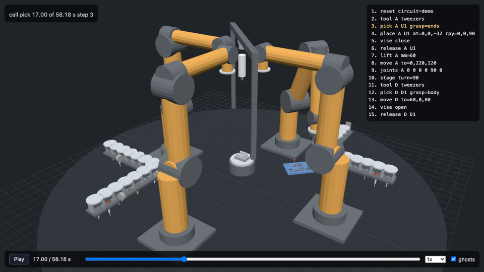
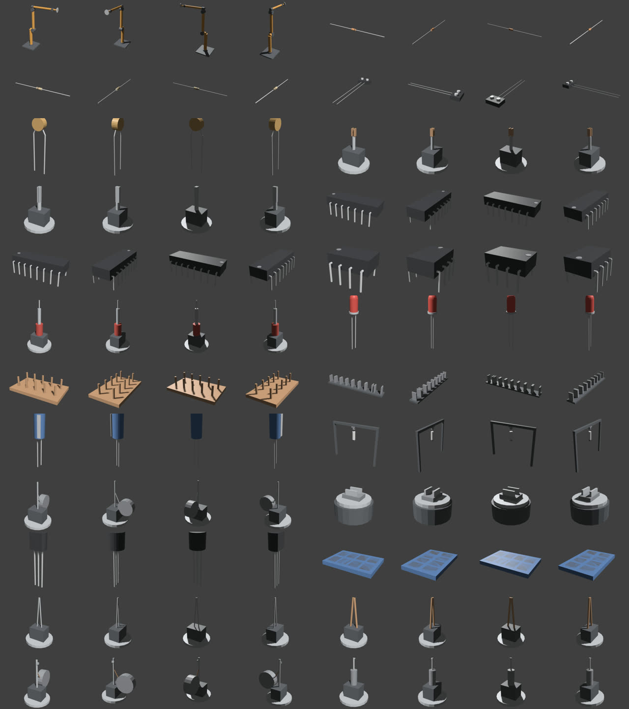

# cell

A robot assembly cell, simulated: four arms, a tool rack, trays of
parts and a microscope that build electronic circuits in free air, in
3D, from the center outward -- two arms hold two parts so that a lead
touches a lead, a third solders them, and the next part comes in. A
program or an LLM agent drives it one command at a time (the design:
docs/cell-design.md in the repository).

Status: the arms move, change tools, pick, place, align and let go of
parts, and stop where they touch; the cell has its 3D models, and a
program can be previewed in a browser, played with a scrubber. The
parts library, the command language (text and JSON, checked against
one table), the cell's state as JSON, four six-axis arms with the
stage and the vise, collision along every motion, and a model of
every piece (built through Blender, checked against the simulator)
are in place: `reset`, `wait s=`, `joints`, `move`, `lift`, `stage`,
`vise`, `tool`, `grip`, `pick`, `place`, `align`, `release` and
`rewind` run; every other command is parsed and checked, then refused
as not simulated yet. Heat and solder, welding, wire, the microscope,
reading and testing parts come next.

- Package: `extensions/cell/` (`extension.toml`; library
  `xetal_ext_cell`: `libxetal_ext_cell.dylib` on macOS, `.so` on
  Linux)
- Facade: `lib/Cell.xtl`, recommended alias `ce:`; the models:
  `lib/CellModels.xtl`, alias `cm:` (pure X_eTaL, through the blender
  extension's `Bpy.xtl`)
- Native crates: `serde`, `serde_json`, `toml`
- Builds for WebAssembly: the simulator has no threads, files or
  clocks (time is the simulation's own), so the same crate will run in
  a browser; the gate builds it for `wasm32-unknown-unknown`

## Functions

| Native name | Arity | X_eTaL type | What |
| ----------- | ----- | ----------- | ---- |
| `about` | 0 | `Unit -> Char` | the extension's name and version |
| `parts` | 0 | `Unit -> Char` | the parts library, one line a kind |
| `part` | 1 | `Char -> Char` | one part kind, its pins worked out, as JSON |
| `commands` | 0 | `Unit -> Char` | the command language, one line a command |
| `parse` | 1 | `Char -> Char` | a program checked against the command table, each command as JSON |
| `run` | 1 | `Char -> Char` | a program run on a new cell, each command's outcome as JSON |
| `state` | 1 | `Char -> Char` | a program run on a new cell, the cell's state after it as JSON |
| `rig` | 0 | `Unit -> Char` | the arm's rig as JSON |
| `scene` | 2 | `Char -> Char -> Char` | a program run on a new cell, written as a scene for the players |
| `arm_model` | 0 | `Unit -> Char` | what a model of the arm must be, as JSON: its pivots, links, check poses and rig |

## From X_eTaL

```
"ce:" u_se< "Cell"
ce:a_bout @                    # cell 0.1.0
ce:p_arts @                    # dip8 8 pins: DIP-8 (NE555 timer) ...
ce:p_art "dip8"                # its body, pins, grasp frames, heat data
ce:c_ommands @                 # lift ARM [mm=MM] -- move the tool straight up ...
ce:p_arse "place A U1 at=0,0,0 rpy=180,0,0"
ce:r_un "move A to=0,0,20 rpy=180,0,0\nlift A mm=30"
ce:s_tate "stage turn=90"          # the time, arms, tracks, stage, timeline
ce:r_ig @                          # the arm's joints, limits, home
```

`ce:p_arse` there prints
`{"op":"place","arm":"A","part":"U1","at":[0.0,0.0,0.0],"rpy":[180.0,0.0,0.0]}`,
and `ce:r_un` one outcome a command:

```
{"ok":true,"command":"move A to=0,0,20 rpy=180,0,0","t0":0.0,"t1":3.932754,"did":["line A to=0,0,20 rpy=180,0,0 in 3.933 s","joints A 0 43.296 17.674 0 29.029 -90"],"events":[],"warnings":[]}
{"ok":true,"command":"lift A mm=30","t0":3.932754,"t1":4.332754,"did":["line A to=0,0,50 rpy=180,0,0 in 0.4 s","joints A 0 39.044 17.584 0 33.372 -90"],"events":[],"warnings":[]}
```

Run with `xetal-x --ext extensions/cell run PROGRAM` (see the
repository's docs/bridge.md).

## The cell

Millimeters, degrees, seconds, grams, watts and degrees Celsius; Z up,
right handed. Four arms, A to D, stand on a ring of 450 mm around the
work zone and 200 mm below it (A at +y, B at -x, C at -y, D at +x),
each facing the center. A new cell (`reset`) has every arm home with
no tool, every rack full, the rotary stage at 0, the vise open, the
time 0; `reset circuit=demo` lays four parts in the tray
(`circuits/demo.toml`: a DIP-8, a resistor, an LED, a ceramic disc).

Around the arms (`layout.rs`, every number illustrative):

- the rotary stage under the work zone, its top 60 mm below the
  origin, with the vise on it: a part whose origin is within 15 mm of
  the vise's middle when it closes (or when an arm lets go of it while
  it is closed) is held, and turns with the stage;
- the microscope on its gantry, turned 135 degrees so its posts stand
  between arms A and B and arms C and D, its lens 330 mm above the
  work zone, clear of the arms' wrists;
- a tool rack beside each arm, each with all seven tools, on the side
  away from the nearer gantry post (one shared rack cannot be reached
  by four arms 900 mm apart: decision C14 in docs/plan.md);
- the parts tray between arms A and D, which only they reach.

The state is plain data and round-trips through JSON exactly: the
time, the circuit, the arms (base, joint angles, tool, track), the
stage and its track, the vise, the parts and the timeline of every
command that ran, its start and end times. Times are kept to the
microsecond. The same program always gives the same state.

## The arms

Every arm is the same generic six-axis arm, `rigs/arm.toml`: base yaw,
shoulder, elbow, and a spherical wrist (roll, pitch, flange roll),
given as classic Denavit-Hartenberg parameters with each joint's
limits, top speed and acceleration, all illustrative. It reaches about
650 mm; at all joints 0 the upper arm stands up and the forearm points
out. Home is that with the wrist pitched 90 degrees, the flange
pointing straight down 100 mm in from the ring and 390 mm above the
work zone -- not a straight wrist, a singularity.

Arms are moved by position, as industrial arms are: kinematic, not
dynamic.

- `joints ARM J1 ... J6` goes to joint angles. Every joint follows a
  trapezoidal profile (accelerate, cruise, decelerate; a triangle
  when the move is short) scaled so that all of them arrive together
  and none passes its speed or acceleration; `speed=` is the fraction
  of each joint's top speed (0.5 if not given).
- `move ARM to=X,Y,Z [rpy=R,P,Y]` takes the flange (the tool point,
  while the arm holds no tool) along a straight line, turning evenly to
  the new orientation (kept if not given), at `speed=` mm a second (100
  if not given; accelerating at 1000). The line is sampled every 1 mm
  and 1 degree; each sample's joint angles come from the inverse
  kinematics, in closed form, the solution nearest the sample before.
  The move is slowed where a joint would pass its top speed. `lift ARM
  mm=` is a move straight up (10 mm if not given).
- Orientation is roll, pitch, yaw in degrees: Rz(yaw) Ry(pitch)
  Rx(roll); a tool's approach is its z axis, so `rpy=180,0,0` points it
  straight down.
- `stage turn=DEG` turns the rotary stage (90 degrees a second,
  accelerating at 360); `vise open|close` takes 0.5 s.

A move that cannot start is refused and changes nothing, saying why: a
joint angle beyond its limits, a point out of reach, every way to
reach it beyond a limit, or a joint that would turn suddenly on the
line (it passes near a singularity: the wrist straight, or the wrist
over the base's axis), each with how far along. Every motion is
recorded in the arm's track, rows of the time and the six angles,
every 50 ms, for a player to draw.

## Grasping and collision

Every motion is checked for collision as it goes, at steps short
enough that no point of the arm moves more than 0.2 mm between two
checks. The cell is solids (`collide.rs`, tested with parry3d): an
arm's links and joint housings as capsules (the sizes CellModels.xtl
draws), its tool as two capsules, a part's body as a box or a
cylinder and each lead as a thin capsule, the fixtures as boxes and
cylinders, and the floor. A motion that meets something stops there,
as a real arm's protective stop does: the motion up to the last clear
step is kept, and the outcome says what touched what, and when --
`collision: arm C link 6 with arm A joint 6 at 53.622 s`. An arm does
not collide with itself (not simulated). Allowed contacts: tweezers
with a part whose grasp frame their tip is on, a part being picked
with what it lay on, a part placed into the vise with the stage, a
lead with the lead it is aligned to, and a tool with its own rack.

- `tool ARM TOOL`: the arm puts back the tool it holds (above its
  slot, down, let go, up) and takes the new one the same way. A tool's
  tip is its model's `tool_tip`, its length out along the flange's z;
  `move` and `lift` move the tip.
- `pick ARM PART grasp=NAME` (tweezers): above the grasp frame, down
  along it, close, lift 30 mm. The tip goes to the frame with the
  tool's z along the frame's -z and its x (the jaws' closing) along
  the frame's x.
- `place ARM PART at= [rpy=]`: the part carried until it is there,
  coming down the last 30 mm slowly.
- `align ARM FRAME to=FRAME [gap=]`: the held part's frame (`R1.1.tip`)
  brought to another part's (`U1.3.tip`) along the line between them,
  stopping `gap` mm short (0.1 if not given), the last 5 mm slowly.
- `release ARM PART` (or `grip ARM open`): the tweezers open. A part
  the vise can hold stays; one held by nothing falls straight down to
  the floor (no tumbling), landing after the time gravity takes, and
  is lost: a warning says how far it fell.
- `grip ARM close`: the tweezers close, taking the part one of whose
  grasp frames is at their tip, if any.
- A command of several motions (`tool`, `pick`, `place`, `align`) is
  planned whole first: if one of its motions cannot be made (out of
  reach, a joint limit, a singularity) the command is refused and
  nothing changes; a collision stops it where it happens.
- `dry=1` runs a command on a copy: the outcome, nothing changed.
- `rewind t=SECONDS` puts the cell back as it was then: the commands
  since the last reset that ended by then run again (the simulation is
  deterministic), and those after stay on the timeline, marked
  `rewound`, so both branches are kept.

A part's and a tool's state is where it started, where it is, what
holds it (an arm, the vise, nothing), whether it is lost, every hold
and every fall: the scene a player draws comes from them, a hold as
`attach` (the vise's riding on the stage) and a fall's landing as
`place`.

## The preview



A program is previewed the way a slicer previews a printer's moves:
the simulator runs it whole, `ce:s_cene` writes its timeline as a
scene, and the three extension's cell player plays it in a browser.

```sh
just preview pick         # programs/pick.cell at http://127.0.0.1:8470/
just check pick           # the same, checked headlessly
```

`programs/NAME.cell` is a program in the command language: `arms`
(the arms, the stage and the vise) and `pick` (tools taken, parts
picked, put in the vise, turned, let fall); `programs/NAME.scene`, if
there is one, holds calls added to the scene for the player (ghosts,
say). The page shows the cell from a camera
you turn by dragging and bring closer with the wheel, a play button,
the time, a scrubber, a speed, the list of steps (click one to go
there) and the ghosts of where parts will end; `window.cell` plays,
seeks and reports the state for a program (three's page says how).

`just check NAME` writes the preview and has headless Chrome (no
window, a throwaway profile) draw it with `?check`: at every `expect`
line -- each arm's flange at the middle and end of steps, from the
simulator's forward kinematics -- the page poses the models and
measures where the flange is drawn. It fails beyond 0.01 mm. For
`pick`, all 72 expectations -- the arms' flanges at the middle and end
of steps, and where every part and tool ends: carried, held by the
vise as the stage turns, fallen -- are drawn where the simulator says;
turning a joint about the wrong axis puts a flange 552 mm off and
fails. It
also keeps a picture, `work/preview/NAME/check.png`.

## Models



`lib/CellModels.xtl` describes every piece of the cell and Blender
builds it (`just models`, about a minute with the stills): the arm,
seven tools (tweezers, iron, solder feeder, heatsink clip, weld
electrodes, flush cutter, wire feeder), the tool rack, a parts tray,
the rotary stage with its vise, the microscope on its gantry, and
every part kind, the resistor's bands from its value (`cm:b_ands`).
Generic shapes, imitating no product. Each is `NAME.glb` with
`NAME.rig.json` beside it, in `work/cell/models`, with four turntable
stills of each in `stills/` (`just sheet` makes the picture above).

- The arm follows the asset contract (docs/cell-design.md): a node a
  joint's pivot, `arm_base`, `arm_j1` to `arm_j6`, `arm_flange`, each
  hanging from the one before, its local z the joint's axis, so
  turning a node about its z is moving that joint. The pivots come
  from the simulator (`ce:a_rmModel`); X_eTaL gives the shapes (joint
  housings, link rods, colors).
- A tool's mount is at its origin, where it meets the flange, and its
  tip is `tool_tip`, out along z (the approach); moving parts are
  nodes (`finger_l`, `finger_r`, `jaw`, `blade_l`, `blade_r`, `spool`).
  The fixtures name their places: `slot1` to `slot7`, `pocket1` to
  `pocket8`, `stage_turn`, `vise_jaw`, `vise_center`, `scope_pan`,
  `scope_tilt`, `lens_l`, `lens_r`, `scope_eye`.
- A part's nodes are its pins, named as the pins (`1`, `2`, ...), at
  the lead's base, each lead's tip (`1.tip`), and its grasp frames
  (`grasp.ends`).

The check (`check.txt`) reads each `.glb` back into an empty scene:
every node of its rig must be where the rig says (to 0.001 mm), each
arm pivot's z its joint's axis, and the arm, posed at three sets of
joint angles, must put its flange where the simulator's forward
kinematics does (to 0.01 mm). `just rigs` then copies the rigs of the
arm, the tools and the fixtures into `rigs/`, and the simulator runs
`rigs/arm.rig.json`: the rig file Blender exported is the one the
simulator reads, and a test checks it is exactly what `rigs/arm.toml`
makes.

## Parts

`parts/*.toml`, one file a part kind, compiled into the library:

| Kind | Pins | Example | Notes |
| ---- | ---- | ------- | ----- |
| `dip8`, `dip14`, `dip16` | 8, 14, 16 | NE555, 74HC00, CD4017 | 2.54 mm pitch, rows 7.62 mm apart; pin 1 at -x on the -y row, counting counterclockwise from above |
| `to92` | 3 | 2N3904 | pins 1 2 3 are E B C, flat face toward -y; heat sensitive |
| `axial-resistor` | 2 | 10 kilohm, 1/4 W | a 6 mm body along x, 28 mm leads |
| `axial-diode` | 2 | 1N4148 | glass DO-35; pin 1 the anode, 2 the cathode |
| `radial-electrolytic` | 2 | 10 uF | pin 1 positive (the longer lead); heat sensitive |
| `ceramic-disc` | 2 | 100 nF | leads 5.08 mm apart |
| `led-5mm` | 2 | red | pin 1 the anode (the longer lead); heat sensitive |
| `battery-snap` | 2 | 9 V snap | pin 1 positive (red), 2 negative (black), 100 mm leads |

Each part's origin is its body's center, Z up with the leads down, as
it lies in a tray. A file gives:

- the body: a `box` (`size`), a `cylinder` or a `d_cylinder` (TO-92's
  flat-sided body: `diameter`, `length`, `axis`, `flat`), and its
  material;
- the pins, each a name, a lead as a polyline out from the body, its
  diameter and material (`copper`, `copper-clad-steel`, `steel`,
  `nickel`), and a role where it matters (`E`, `anode`, `+`) -- or,
  for a DIP, a `pin_pattern` the pins are worked out from. A pin is
  named `PART.PIN` (`U1.3`), its lead's free end `U1.3.tip`;
- grasp frames, where tweezers may hold: the jaws' center, the frame's
  roll, pitch and yaw (the jaws close along its x and approach along
  its -z), and the width between the jaws;
- thermal data: the body's mass and heat capacity and its limit (a
  temperature for a time). Every number is listed in `sourced`, with
  the `source` it comes from, or in `illustrative`: chosen as
  plausible, not taken from a source. The body limits of 260 C for
  10 s cite IEC 60068-2-20 (resistance to soldering heat); the masses
  and heat capacities are illustrative, as are the lower limits of the
  electrolytic's sleeve, the LED and the snap.

The files are checked when read: shapes and their sizes, unique pin
and grasp names, leads of two points or more, known materials, and
every thermal number accounted for exactly once.

## Commands

One command a line as text, several on a line split by `;`, `#`
starting a comment; or one JSON object a line, positional arguments
named:

```
tool C iron temp=350
touch C at=U1.3+R1.1 dwell=1.5 ; feed D mm=1.2
{"op": "lift", "arm": "C", "mm": 5}
```

Any command takes `dry=1` (`"dry": true`): it runs on a copy and
changes nothing. A command that cannot start is refused and changes
nothing; each says what happened (`ok`, its times, its motions, why it
was refused or where it stopped, events and warnings).

The table below is made from the simulator's command table, the same
table the parser checks against and the MCP tools' schemas come from
(`just command-table` prints it; a test fails when this page differs).
Units are in the placeholders: `MM`, `DEG`, `S`, `C`, `J`;
`N` is a plain number.

| Command | Family | Does |
| ------- | ------ | ---- |
| `reset [circuit=NAME]` | cell | the cell as it starts: arms home, tools in the rack, the trays filled for a circuit |
| `tool ARM TOOL [temp=C]` | arm | change the arm's tool at the rack |
| `joints ARM J1 J2 J3 J4 J5 J6 [speed=N]` | arm | move the arm to absolute joint angles, all joints arriving together |
| `move ARM to=X,Y,Z [rpy=R,P,Y] [speed=MM/S]` | arm | move the tool to a pose, by inverse kinematics, in a straight line |
| `lift ARM [mm=MM]` | arm | move the tool straight up |
| `grip ARM open\|close [force=N]` | tweezers | open or close the tweezers |
| `pick ARM PART grasp=NAME` | tweezers | approach a part, close on a grasp frame, lift it |
| `place ARM PART at=X,Y,Z [rpy=R,P,Y]` | tweezers | carry the held part to a pose |
| `align ARM FRAME to=FRAME [gap=MM]` | tweezers | bring a frame of the held part to another frame, a gap apart |
| `release ARM PART` | tweezers | open the tweezers and let the part go |
| `clip ARM on=PIN at=MM` | clip | clip a heatsink on a lead, between the body and the joint |
| `touch ARM at=JOINT [dwell=S]` | iron | put the iron's tip on a joint and hold it there |
| `feed ARM mm=MM [rate=MM/S]` | solder | feed solder wire into the joint the iron is on |
| `weld ARM at=JOINT energy=J [risky=refuse\|allow]` | welder | spot weld a lap of two leads by a capacitor discharge |
| `wire ARM awg=N mm=MM` | wire | feed bare or enameled wire from a spool out of the nozzle |
| `cut ARM` | cutter | cut the wire or the lead in the cutter's jaws |
| `stage turn=DEG` | stage | turn the rotary stage by an angle |
| `vise open\|close` | stage | open or close the vise on the stage |
| `wait [s=S] [until=TARGET] [below=C]` | cell | let time pass, or wait until a pin or joint cools |
| `scope [pan=DEG] [tilt=DEG] [zoom=N] [focus=MM] [rotate=DEG] [aim=TARGET]` | scope | move the microscope: pan, tilt, zoom, focus, rotate, or aim it at a target |
| `snap [stereo=N]` | scope | take the microscope's picture |
| `inspect TARGET` | scope | report a joint's gap, fillet and result, or a pin's temperature |
| `probe PIN PIN` | scope | measure continuity and resistance between two pins |
| `rewind t=S` | cell | put the cell back as it was at a time (the timeline keeps both branches) |

Arguments: `ARM` is A to D; `TOOL` one of tweezers, iron, solder,
clip, welder, cutter, wire; `PART` an id (`U1`); `PIN` `U1.3`;
`FRAME` a part, a pin or a pin's tip; `JOINT` two pins, `U1.3+R1.1`;
`TARGET` a pin or a joint. Every number has limits (an iron from 150
to 450 C, a move up to 500 mm/s, wire from 22 to 34 AWG), and a value
outside them is refused with the limits named.

## Build and test

```sh
just build          # the native library and xetal-x
just test           # Rust tests (rust/tests) and reg-rs tests (tests/)
just wasm           # build the crate for the browser (wasm32)
just list           # the functions as xetal-x sees them
just command-table  # the command table as markdown, for this page
just models         # every model through Blender, checked, with stills
just rigs           # copy the models' rigs the simulator reads into rigs/
just sheet          # the stills as one picture, docs/models.jpg
just preview NAME   # programs/NAME.cell previewed at http://127.0.0.1:8470/
just check NAME     # the preview checked by headless Chrome
```

## Demos

None yet: `demos/NAME.xtl`, run with `just demo NAME`.
